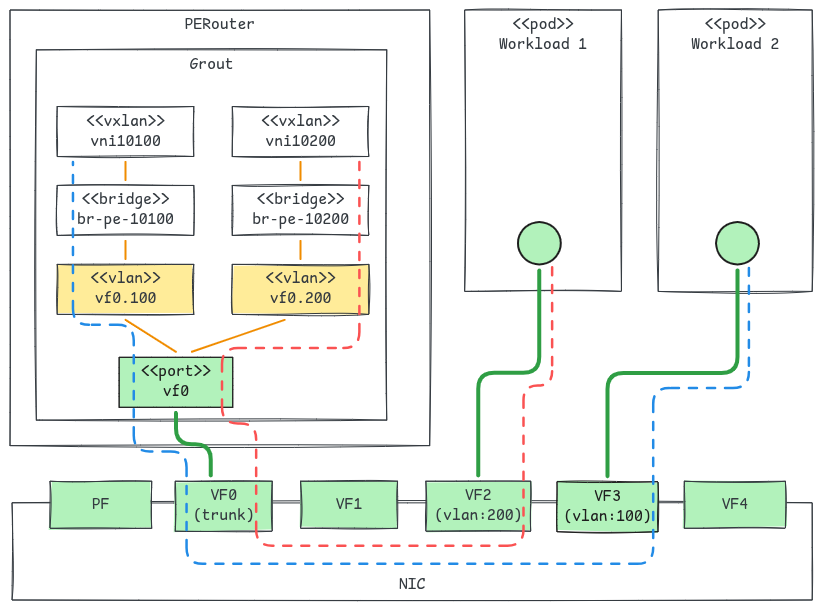

# Grout L2Trunk: VLAN Trunks and SR-IOV VF-to-VF Communication

## Summary

This enhancement implements the `L2Trunk` resource, proposed in
[L2VNI VLAN Trunks](https://github.com/openperouter/openperouter/pull/783),
on the grout data path, and extends it with a `VirtualFunction` attachment
type that provides hardware-accelerated VF-to-VF communication for L2VNIs.

An `L2Trunk` owns a single attachment that carries 802.1Q-tagged traffic for
every L2VNI that references it. On grout, the attachment depends on
`L2Trunk.spec.hostMaster.type`:

- `LinuxBridge` and `OVSBridge`: grout creates one TAP port pair for the
  trunk. The host side is attached to the host bridge; on the grout side,
  one VLAN interface per referencing L2VNI is created on the TAP port and
  attached to that L2VNI's grout bridge.
- `VirtualFunction` (new, grout only): an SR-IOV VF is bound to grout and
  used directly as the trunk port. One VLAN interface per referencing L2VNI
  is created on the VF port and attached to that L2VNI's grout bridge.
  Workloads consume other VFs of the same Physical Function (PF), configured 
  with the L2VNI's VLAN, and the NIC's embedded switch forwards local 
  VF-to-VF traffic.

This covers milestone **M3a** of the
[grout dataplane enhancement](grout-dataplane.md).

## Motivation

The [grout dataplane enhancement](grout-dataplane.md) exposes each L2VNI to
the host through a dedicated TAP port pair (milestone M3). Every packet
between a local workload and the overlay crosses the TAP, and every L2VNI
costs one TAP port pair and, usually, one host bridge (Linux Bridge or OVS).

This enhancement allows L2VNI communication without any kernel netlink device
by leveraging SR-IOV devices and VF to VF communication.

A trunk VF is a shared attachment carrying tagged traffic for many L2VNIs,
which is what `L2Trunk` models for the kernel data path. Expressing the VF as
an `L2Trunk` attachment type means the VF is described once, has a clear
owner whose deletion releases it, and uses the same VLAN-to-VNI mapping API
as host bridge trunks. Implementing the host bridge trunk types on grout as
well gives both data paths the same API for VLAN-tagged L2VNIs.

### Goals

- Implement `L2Trunk` and `L2VNI.spec.trunk` on the grout data path for the
  `LinuxBridge` and `OVSBridge` host master types.
- Add a `VirtualFunction` host master type to `L2Trunk` that binds an
  SR-IOV VF to grout as the trunk port.
- Map each L2VNI's VLAN tag to its VXLAN VNI with one grout VLAN interface
  per L2VNI.
- Remain compatible with the sriov-device-plugin and
  sriov-network-operator: workloads consume VFs through standard `sriov`
  NetworkAttachmentDefinitions.

### Non-Goals

- Managing workload VFs (VLAN assignment, driver binding, allocation to
  pods). The user or the sriov-network-operator does this.
- Supporting the `VirtualFunction` type on the kernel data path.
- Changing how grout handles standalone L2VNIs (L2VNIs without `trunk`):
  they keep their dedicated TAP port pair.
- Untagged traffic on a trunk. As in the kernel proposal, untagged frames
  and unconfigured tags are dropped.

## Design

### API Changes

The `L2Trunk` resource and the `L2VNI.spec.trunk` field are defined by the
[L2VNI VLAN Trunks](https://github.com/openperouter/openperouter/pull/783)
proposal and are not changed here. This enhancement adds a
`VirtualFunction` member to the host master union used by `L2Trunk`:

```go
// L2TrunkHostMaster selects the attachment that carries the trunk's
// tagged traffic.
// +union
// +kubebuilder:validation:XValidation:rule="self.type != 'LinuxBridge' || (has(self.linuxBridge) && !has(self.ovsBridge) && !has(self.virtualFunction))",message="type LinuxBridge requires only linuxBridge to be set"
// +kubebuilder:validation:XValidation:rule="self.type != 'OVSBridge' || (has(self.ovsBridge) && !has(self.linuxBridge) && !has(self.virtualFunction))",message="type OVSBridge requires only ovsBridge to be set"
// +kubebuilder:validation:XValidation:rule="self.type != 'VirtualFunction' || (has(self.virtualFunction) && !has(self.linuxBridge) && !has(self.ovsBridge))",message="type VirtualFunction requires only virtualFunction to be set"
type L2TrunkHostMaster struct {
	// type of the trunk attachment.
	// +kubebuilder:validation:Enum=LinuxBridge;OVSBridge;VirtualFunction
	// +required
	// +unionDiscriminator
	Type string `json:"type,omitempty"`

	// linuxBridge configuration. Must be set when type is "LinuxBridge".
	// +optional
	LinuxBridge *LinuxBridgeConfig `json:"linuxBridge,omitempty"`

	// ovsBridge configuration. Must be set when type is "OVSBridge".
	// +optional
	OVSBridge *OVSBridgeConfig `json:"ovsBridge,omitempty"`

	// virtualFunction configuration. Must be set when type is
	// "VirtualFunction". Only supported by the grout data path.
	// +optional
	VirtualFunction *VirtualFunctionConfig `json:"virtualFunction,omitempty"`
}

// VirtualFunctionConfig identifies the SR-IOV VF bound to grout as the
// trunk port.
type VirtualFunctionConfig struct {
	// netlinkName is the kernel network interface name of the VF
	// (e.g. "enp1s0v3"). The controller resolves it to a PCI address.
	// The VF must have no VLAN configured so it receives the tagged frames
	// of every workload VF on the same PF.
	// +kubebuilder:validation:Pattern=`^[a-zA-Z][a-zA-Z0-9._-]*$`
	// +kubebuilder:validation:MinLength=1
	// +kubebuilder:validation:MaxLength=15
	// +required
	NetlinkName string `json:"netlinkName,omitempty"`

	// acceleratedConfig sets optional grout port parameters for the VF.
	// +optional
	AcceleratedConfig *AcceleratedConfig `json:"acceleratedConfig,omitempty"`
}
```

`AcceleratedConfig` is the type already used by DPDK-accelerated underlay
interfaces (`NetworkDevice.acceleratedConfig`), reused unchanged so that
grout ports are tuned the same way regardless of their role:

```go
// AcceleratedConfig holds optional grout port parameters.
type AcceleratedConfig struct {
	// rxQueues is the number of receive queues to allocate on the DPDK port.
	// +kubebuilder:validation:Minimum=1
	// +kubebuilder:validation:Maximum=64
	// +optional
	RXQueues *int32 `json:"rxQueues,omitempty"`
	// qSize is the descriptor ring size for each receive queue. Larger
	// rings absorb traffic bursts at the cost of memory.
	// +kubebuilder:validation:Minimum=64
	// +kubebuilder:validation:Maximum=32768
	// +optional
	QSize *int32 `json:"qSize,omitempty"`
}
```

When `acceleratedConfig` or one of its fields is omitted, grout's defaults
apply, as for underlay ports.

`L2Trunk` gets its own host master type rather than extending the
`HostMaster` type used by L2VNIs, so that a standalone L2VNI cannot select a
VF: a VF only makes sense as a tagged trunk.

#### Examples

A VF trunk shared by two L2VNIs:

```yaml
apiVersion: network.openperouter.io/v1alpha1
kind: L2Trunk
metadata:
  name: workloads
spec:
  hostMaster:
    type: VirtualFunction
    virtualFunction:
      netlinkName: enp1s0v0
      acceleratedConfig:
        rxQueues: 4
        qSize: 2048
---
apiVersion: network.openperouter.io/v1alpha1
kind: L2VNI
metadata:
  name: tenant-a
spec:
  vni: 10100
  trunk:
    name: workloads
    vlan:
      tag: 100
---
apiVersion: network.openperouter.io/v1alpha1
kind: L2VNI
metadata:
  name: tenant-b
spec:
  vni: 10200
  trunk:
    name: workloads
    vlan:
      tag: 200
```

The other VFs of the PF that owns `enp1s0v0` are configured with VLAN 100 or
200 and assigned to pods through `sriov` NetworkAttachmentDefinitions.

The following diagram shows the port configuration in case two workloads 
want to use the L2VNIs



The same L2VNIs attached to a host bridge instead only change the trunk:

```yaml
apiVersion: network.openperouter.io/v1alpha1
kind: L2Trunk
metadata:
  name: workloads
spec:
  hostMaster:
    type: LinuxBridge
    linuxBridge:
      lifecycle: External
      name: br-workloads
```

In this case, the workloads pod will have to use Linux Bridge CNI or OVS CNI to 
connect to the bridge.

### Grout Data Path

For every L2VNI, trunk-attached or not, grout keeps the per-VNI layout of
milestone M3: a VXLAN interface and a bridge per VNI, in the VRF of the
L2VNI's routing domain, with the L2 gateway addresses assigned to the
bridge. Grout bridges are not VLAN-aware, so the VLAN-to-VNI mapping is done
by a grout VLAN interface per L2VNI, created on the trunk port with the
L2VNI's tag and attached to the L2VNI's bridge. The VLAN interface strips
the tag on ingress and adds it on egress.

The attachment type only decides what the trunk port is.

#### LinuxBridge and OVSBridge trunks

```
Grout:  vxlan<VNI-A> ── bridge<VNI-A> ── trunk port.100 ──┐
        vxlan<VNI-B> ── bridge<VNI-B> ── trunk port.200 ──┤
                                                          │
                                           trunk port (TAP, grout side)
                                                          │ tagged 100, 200
Host:                                      trunk TAP (host side)
                                                          │
                                           br-workloads (VLAN filtering)
                                              │                │
                                          pod (100)        pod (200)
```

- One TAP port pair is created per `L2Trunk` when the trunk is created,
  even if no L2VNI references it yet.
- The host side of the TAP is attached to the bridge selected by
  `hostMaster`, with the same lifecycle semantics as a standalone L2VNI's
  host master. It carries tagged traffic only.
- For each L2VNI referencing the trunk, a VLAN interface with the L2VNI's
  tag is created on the grout side of the TAP and attached to the L2VNI's
  bridge.

#### VirtualFunction trunks

```
Grout:  vxlan<VNI-A> ── bridge<VNI-A> ── trunk port.100 ──┐
        vxlan<VNI-B> ── bridge<VNI-B> ── trunk port.200 ──┤
                                                          │
                                           trunk port (DPDK, enp1s0v0)
                                                          │ tagged 100, 200
NIC:                          trunk VF (no VLAN) ◄── embedded switch ──┐
                                                     │                 │
                                      workload VF (VLAN 100)  workload VF (VLAN 200)
                                                     │                 │
Host:                                             pod A             pod B
```

- When the `L2Trunk` is created, the VF is prepared for DPDK and added to
  grout as a port, following the same flow as
  [DPDK-accelerated underlay ports](grout-dpdk-underlay.md): the original
  device state is saved, then the VF is bound to `vfio-pci` or, for
  bifurcated drivers, kept on its kernel driver. The port is created with
  the `rxQueues` and `qSize` set in `virtualFunction.acceleratedConfig`.
- For each L2VNI referencing the trunk, a VLAN interface with the L2VNI's
  tag is created on the VF port and attached to the L2VNI's bridge.
- No TAP port pair and no host bridge are created.
- Traffic between workload VFs on the same VLAN is switched by the NIC and
  never reaches grout. Traffic to remote endpoints and to the L2 gateway
  reaches grout through the trunk VF, tagged with the workload's VLAN.

VLAN isolation between workloads is enforced by the NIC: each workload VF
has its VLAN set on the PF, so the workload cannot choose its tag.

### Lifecycle

- Creating an `L2Trunk` creates its trunk port: the TAP port pair, or the
  VF bound to grout.
- Adding an L2VNI to a trunk creates its VXLAN interface, bridge and VLAN
  interface. Removing it deletes them, leaving the trunk port and the other
  L2VNIs' VLAN interfaces untouched.
- Deleting an `L2Trunk` deletes the VLAN interfaces on its port and the port
  itself. A VF is then handed back to the kernel using its saved device
  state, as for an accelerated underlay port. As in the kernel proposal, the
  referencing L2VNIs remain in the API but lose their data plane
  configuration.
- `hostMaster` is immutable: changing the attachment type or the VF requires
  deleting and recreating the trunk.
- Grout ports and VLAN interfaces that do not belong to any configured trunk
  or L2VNI, for example after a controller restart, are removed during
  reconciliation.

### Prerequisites for VirtualFunction trunks

- The grout data path is enabled.
- SR-IOV is enabled on the PF and the trunk VF has no VLAN configured.
- The trunk VF is not allocated to workloads, for example by excluding it
  from the sriov-device-plugin resource pools.
- Workload VFs are configured with the VLAN tags of the L2VNIs they belong
  to, by the user or by the sriov-network-operator.

### Validation

On top of the `L2Trunk` validation of the kernel proposal:

- Exactly one host master member, matching `type`, is set (CEL).
- `type: VirtualFunction` is rejected by the webhook, and reported by the
  controller, when the data path is not grout.
- Tags are unique per trunk per node; different trunks can use the same tag.

### Test Plan

#### E2E tests with host bridge trunks

The grout kind lanes run the same `L2Trunk` tests as the kernel data path,
with `LinuxBridge` and `OVSBridge` host masters. On grout, the trunk is
carried by a TAP port pair, so the tests need no special hardware.

#### E2E tests with VirtualFunction trunks

CI has no SR-IOV NICs, so the `VirtualFunction` tests run on the QEMU
hardware emulation lane, where the Kubernetes node is a QEMU VM running
inside the `pe-kind-control-plane` containerlab node. On top of the
underlay NICs, the QEMU entrypoint script creates a set of virtio NICs that
act as the VFs of one PF. A VLAN-filtering Linux bridge in the containerlab
node, the hypervisor in this setup, acts as the PF's embedded switch:

```
QEMU VM (k8s node):  toleafkind1   toleafkind1v1   toleafkind1v2..v3   toleafkind1v4..v5
                     (underlay)    (trunk VF,      (workload VFs,      (workload VFs,
                                    grout port)     macvlan pods)       macvlan pods)
                          │             │                │                   │
                       virtio        virtio           virtio              virtio
                          │             │                │                   │
Hypervisor:         toleafkind1_t  toleafkind1v1_t  toleafkind1v2..3_t  toleafkind1v4..5_t
                     PVID 1        tagged 33, 44    PVID 33, untagged   PVID 44, untagged
                          │             │                │                   │
                          └─────────────┴──── toleafkind1_br ────────────────┘
                                             (vlan_filtering=1)
                                                    │
                                         toleafkind1 (clab veth to leafkind1)
```

- Every emulated VF is a `virtio-net-pci` device on its own PCIe root
  port, behind the vIOMMU, backed by a TAP in the containerlab node. Udev
  rules rename them in the guest to `toleafkind1v<N>`, so the `L2Trunk`
  references a stable name.
- The TAPs are attached to `toleafkind1_br`, the bridge that already
  connects the `toleafkind1` underlay NIC to the leaf. The bridge has VLAN
  filtering enabled; the underlay ports keep the default PVID 1, so the
  underlay traffic is unaffected.
- The trunk VF TAP is a tagged member of VLANs 33 and 44, like a VF with no
  VLAN configured.
- The workload VF TAPs are access ports with PVID 33 or 44 and untagged
  egress, like VFs whose VLAN is set on the PF. The workload cannot choose
  its tag, which is the isolation property of a real NIC.
- The test creates an `L2Trunk` with `type: VirtualFunction` pointing at
`toleafkind1v1`.

The emulation does not cover the sriov-device-plugin and the SR-IOV CNI,
which only work with real VFs.

## Drawbacks

- The `VirtualFunction` type requires SR-IOV NICs and relies on the user or
  the sriov-network-operator to configure workload VFs. A wrong VLAN on a
  workload VF results in silent connectivity failures.
- The VF name is node-local, so an `L2Trunk` applied to several nodes
  requires consistent VF naming across them.
- Part of the `L2Trunk` API is only valid on the grout data path.

## Alternatives Considered

### VF selector on each L2VNI

Add a field to `L2VNISpec`, mutually exclusive with `hostMaster`, carrying
the trunk VF and the VLAN tag. It needs no new resource, but every L2VNI
sharing the VF repeats it, nothing prevents inconsistent descriptions of the
same VF, and the VF has no single owner whose deletion releases it. It would
also diverge from the trunk API used by the kernel data path.

### One TAP port pair per L2VNI on host bridge trunks

Keep a TAP port pair per L2VNI and attach each host-side TAP to the host
bridge as an access port on the L2VNI's VLAN. This avoids grout VLAN
interfaces but keeps one TAP port pair per VNI, and requires OpenPERouter to
configure VLAN membership on the host bridge, which may be externally owned.

### VLAN-aware grout bridge

Use a single grout bridge with VLAN-to-VNI mappings, mirroring the kernel
proposal's VLAN-aware bridge. Grout bridges are not VLAN-aware, and the
anycast gateway is assigned per bridge, so per-VNI bridges with VLAN
interfaces are used instead.
This proposal will be evaluated and discussed with the Grout community
in case the per-VNI bridge design shows scalability limitations (e.g. 
when thousands of VNIs are created).
