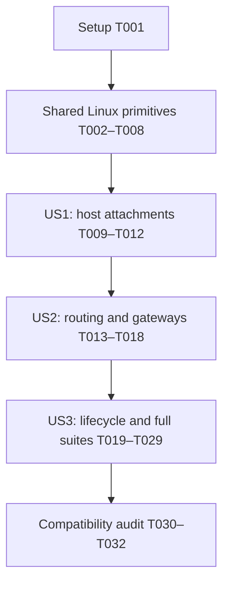

# Tasks: Reimplement Existing VNIs with VLAN-Aware Bridges

**Input**: Design documents in `specs/001-reimplement-vlan-aware-bridge/`
**Prerequisites**: [plan.md](plan.md), [spec.md](spec.md), [research.md](research.md), [data-model.md](data-model.md), [compatibility contract](contracts/compatibility.md), [quickstart.md](quickstart.md)
**Generated**: 2026-10-28

**Tests**: Existing e2e compatibility is explicitly required. The plan also requires meaningful privileged regression proof for new kernel topology, VNI-filter encoding, repair and cleanup. Add/update these internal tests before their implementation and demonstrate the relevant failure where practical; do not rewrite existing e2e manifests, assertions, deadlines, or filters. A test cannot pass by skipping unsupported required operations.

**Organization**: Tasks follow the three user stories. Shared primitives precede story integration. Every task is initially unchecked; this file records planned work, not completed implementation.

## Format: `[ID] [P?] [Story] Description`

- `[P]` identifies independent work on different files within a phase after its prerequisites are satisfied. It permits parallel execution but does not require agent delegation.
- Story-phase tasks carry `[US1]`, `[US2]`, or `[US3]`; shared and final tasks do not.
- Paths are relative to the repository root. New filenames below are the concrete task targets; reuse an existing responsible file if that keeps the implementation smaller and update this list accordingly.
- Read `CODING_STYLE.md` before code changes. Use `writecommit` if a commit is requested or otherwise needed; task completion does not require a commit per checkbox.

## Phase 1: Setup (Shared Infrastructure)

**Purpose**: Establish the existing compatibility baseline without initializing a new project or changing dependencies.

- [X] T001 Read `AGENTS.md`, `CODING_STYLE.md` and this feature's design; record the starting revision, clean/dirty baseline, public-contract/e2e file fingerprints, existing CI mode filters, and available kernel/FRR/container prerequisites in `specs/001-reimplement-vlan-aware-bridge/validation.md`, using `.github/workflows/ci.yaml`, `api/v1alpha1/`, `api/static/config.go`, `config/crd/bases/`, and `e2etests/` as baseline sources; do not infer successful runtime support from versions alone.

## Phase 2: Foundational (Blocking Prerequisites)

**Purpose**: Build the common Linux bridge, VXLAN and addressless endpoint support needed by both P1 stories.

**Blocking gate**: Complete T002–T008 before integrating either user story. Keep Grout and host-side bridge creation on their existing paths.

- [X] T002 [P] Add focused wire-format regression tests in `internal/hostnetwork/vxlan_filter_linux_test.go` for atomic external+vnifilter creation attributes, IPv4/IPv6 VTEPs, UDP-port byte order, tunnel-header encoding, single-VNI add/dump/delete parsing, malformed/truncated replies, and propagated kernel errors; use the existing pinned libraries and no new test framework.
- [X] T003 [P] Add privileged shared-topology tests in `internal/hostnetwork/vlan_test.go` and `internal/hostnetwork/vxlan_test.go` with the existing `runasroot` harness for VLAN-filtering bridges with default PVID 0, explicit VLAN 1 membership, addressless VRF-bound endpoints, metadata VXLAN filter/mapping state, VNI values above 4094, maximum interface-name length, and two dedicated domains reusing VLAN 1.
- [X] T004 Implement the narrow rtnetlink helper in `internal/hostnetwork/vxlan_filter_linux.go` using existing `netlink/nl` and x/sys: create external+vnifilter together, query the otherwise-unparsed vnifilter flag, and add/list/delete single-VNI receive filters using RTM tunnel messages; validate lengths/nesting and preserve errors with context, without dependency upgrades or runtime shell provisioning (depends on T002).
- [X] T005 Implement private VLAN 1/name helpers and dedicated switching-bridge/addressless-SVI setup in `internal/hostnetwork/vlan.go` and `internal/hostnetwork/bridge.go`: use `br-vl-<VNI>` without a VRF master, explicit VLAN self membership, pinned node-local router MACs and disabled IPv6 address generation on addressless links; keep `BridgeName(VNI)` returning `br-pe-<VNI>` and leave host bridge creation unchanged (depends on T003).
- [X] T006 Update creation and comparison in `internal/hostnetwork/vxlan.go` to preserve `vni<VNI>`, VTEP/underlay-device/port settings, nolearning and suppression while using T004's external+vnifilter helper; reconcile VLAN 1 port membership, VLAN tunnel mode, the VLAN-to-VNI mapping and receive-filter entry independently, instead of comparing fixed `VxlanId` with VNI (depends on T004, T005).
- [X] T007 Integrate the shared switching/tunnel/addressless-endpoint chain in `internal/hostnetwork/vni.go`, moving VRF membership to the endpoint, retaining L3 host-session behavior and existing payload MTU calculations; extend the basic owned namespace cleanup to recognize `br-vl-*`, VLAN and macvlan children so intermediate test runs leave no new devices behind (depends on T005, T006).
- [X] T008 Execute the focused privileged shared-topology tests from `internal/hostnetwork/vlan_test.go` and `internal/hostnetwork/vxlan_test.go` through the existing container/OVS harness in `Makefile` and `hack/integration_tests.sh`; prove actual external+vnifilter operations, same-port dispatch and independent VLAN reuse, and record results in `specs/001-reimplement-vlan-aware-bridge/validation.md` before continuing (depends on T007).

**Checkpoint**: Shared Linux primitives work on the real target kernel; existing public types, conversion inputs and Grout naming are unchanged.

## Phase 3: User Story 1 — Keep Existing Workload Attachments Working (Priority: P1)

**Goal**: Existing untagged host attachments and disconnected Layer 2 forwarding work through the new internal bridge model.

**Independent Test**: Privileged Linux/OVS/omitted-host-master attachment cases pass, and existing disconnected-overlay e2e scenarios communicate across nodes without gateways or routing domains. Capture confirms untagged host traffic. Routed host-master e2e cases also run after US2 supplies their gateways.

### Tests for User Story 1

- [X] T009 [P] [US1] Update private topology assertions and add access-port regression cases in `internal/hostnetwork/vni_test.go` for unchanged host/router veth names, VLAN 1 PVID/untagged membership, omitted `hostMaster`, managed/external Linux bridges, disconnected forwarding, and unchanged effective veth MTUs; preserve the existing behavioral assertions.
- [X] T010 [P] [US1] Update kernel-side topology expectations in `internal/hostnetwork/vni_ovs_bridge_test.go` while retaining current managed/external OVS attachment, shared external bridge ownership, and repeat-setup expectations; do not change host-facing tagging or OVS lifecycle semantics.

### Implementation and validation for User Story 1

- [X] T011 [US1] Update `SetupL2VNI` and its router-side attachment in `internal/hostnetwork/vni.go` to enslave the existing router veth to the private switching bridge and ensure VLAN 1 PVID/untagged access membership; preserve `SetupHostMaster`, external attachment when omitted, host interface names, and current MTU values (depends on T009, T010).
- [X] T012 [US1] Run the attachment regressions in `internal/hostnetwork/vni_test.go` and `internal/hostnetwork/vni_ovs_bridge_test.go`, then deploy through `deploy` into fresh router namespaces without legacy VNI devices and run the existing disconnected-overlay scenarios in `e2etests/tests/evpn_l2.go` through `e2e-tests` with normal mode filters plus a temporary focus; capture untagged host traffic and record exact commands/results in `specs/001-reimplement-vlan-aware-bridge/validation.md` without editing suite files (depends on T011).

**Checkpoint / suggested MVP**: The disconnected Layer 2 replacement is independently demonstrated. This is an engineering checkpoint; release acceptance still requires US2, US3 and full unchanged suites.

## Phase 4: User Story 2 — Keep Existing Routing and Gateways Working (Priority: P1)

**Goal**: Preserve existing gateways, routing-domain relationships, policies and packet sizes with the new VLAN endpoint layout.

**Independent Test**: Existing L3VNI/L3VPN gateway connectivity, shared-L3VNI symmetric routing, RT/RD and address-family scenarios pass; gateway neighbors remain on `br-pe-<VNI>` and existing maximum-MTU checks succeed.

### Tests for User Story 2

- [X] T013 [P] [US2] Add privileged routed-topology regressions in `internal/hostnetwork/vlan_gateway_test.go` for the direct `br-pe-<VNI>` VLAN SVI gateway, existing deterministic anycast MAC/IPs, VRF membership, local gateway FDB entry, IPv4/IPv6/dual-stack gateways, L3 addressless endpoints, and multiple L2 domains sharing an L3 routing domain.
- [X] T014 [P] [US2] Adapt private fixture setup and add neighbor-owner regression proof in `internal/hostnetwork/bridgerefresh/vlan_test.go` alongside existing refresher, neighbor, and ping tests so the unchanged `br-pe-<VNI>` lookup and ICMP binding exercise the real VLAN gateway interface, while retaining existing stale-neighbor/address-family expectations.

### Implementation and validation for User Story 2

- [X] T015 [US2] Extend `internal/hostnetwork/vlan.go` with the direct gateway VLAN SVI and idempotent VLAN-scoped local FDB programming: keep `BridgeFixedMAC(VNI)` on the `br-pe-<VNI>` gateway, bind the routed endpoint to the existing VRF, place configured CIDRs only on the gateway, and retain node-local router MACs on addressless devices (depends on T013).
- [X] T016 [US2] Integrate gateway and routing-domain endpoint selection in `internal/hostnetwork/vni.go` and `internal/hostnetwork/bridge.go`: use the direct addressless `br-pe-<VNI>` SVI for L3 and gateway-free L2, use the same VLAN endpoint with the existing anycast MAC/IPs for gateway-bearing L2, preserve L3-before-L2 setup, host sessions and L3VPN references, and remove obsolete gateway-address assignment to the switching bridge (depends on T015).
- [X] T017 [US2] Verify `internal/hostnetwork/bridgerefresh/refresher.go`, `internal/hostnetwork/bridgerefresh/neighbor.go`, and `internal/hostnetwork/bridgerefresh/ping.go` continue targeting the actual `br-pe-<VNI>` neighbor owner after successful setup in `internal/controller/routerconfiguration/host_config.go`; change only wiring/comments that need correction, preserve shared Grout behavior and current refresh deadlines, and pass T014's regressions (depends on T014, T016).
- [ ] T018 [US2] Run focused existing routed scenarios from `e2etests/tests/evpn_l2.go`, `e2etests/tests/evpn_l2vnis_with_same_l3vni.go`, `e2etests/tests/l3vpn_l2.go`, `e2etests/tests/mixed_l3vpn_l3vni.go`, `e2etests/tests/route_target.go`, `e2etests/tests/ipv6_vtep.go`, and `e2etests/tests/underlay_address_families.go` through `deploy`/`e2e-tests`; verify FRR L2/L3 discovery, same-port coexistence, routing policy and existing maximum MTU, capture absence of added inner VLAN headers, and record evidence in `specs/001-reimplement-vlan-aware-bridge/validation.md` (depends on T017).

**Checkpoint**: Current attachment and routing flows work; no API/static configuration or FRR policy changes are required to express the internal VLAN.

## Phase 5: User Story 3 — Retain Lifecycle and Recovery Behavior (Priority: P2)

**Goal**: Reconciliation, conversion of owned legacy devices, deletion and recovery retain existing behavior, followed by full unchanged-suite acceptance.

**Independent Test**: Privileged fault-injection and lifecycle regressions pass, existing silent-workload/movement/restart scenarios retain their deadlines, and full pod/host/boot/Grout suites pass with the existing filters and assertions.

### Tests for User Story 3

- [X] T019 [P] [US3] Add privileged lifecycle regressions in `internal/hostnetwork/vni_lifecycle_test.go` for grouped legacy fixed-ID VXLAN removal before same-port replacement, freeing old owned `br-pe-*` bridge names, repeated setup without link/MAC/address churn, deleted or incorrect membership/mapping/filter/FDB repair, immutable mismatch replacement, partial setup retry, namespace/underlay reconstruction, complete cleanup, and survival of unrelated devices/external host bridges/remaining VNIs.
- [X] T020 [P] [US3] Extend lifecycle regression coverage in `internal/hostnetwork/bridgerefresh/vlan_test.go` alongside `registry_test.go` for registry start/stop/replacement behavior; controller stop/delete/setup/restart ordering is tested in T023; retain cleanup of removed VNIs and the existing independent Grout-compatible naming behavior.

### Implementation and validation for User Story 3

- [X] T021 [US3] Implement owned-legacy-topology detection/removal in `internal/hostnetwork/vni_legacy.go` and invoke it only from the kernel path in `internal/controller/routerconfiguration/host_config.go` before the first external VXLAN is created: stop affected refreshers, remove all owned old fixed-ID VXLANs first, free old router bridge names, preserve host attachments where possible, and never select unrelated devices by UDP port alone (depends on T019, T020).
- [X] T022 [US3] Complete fault repair and no-op reconciliation in `internal/hostnetwork/vxlan.go`, `internal/hostnetwork/vxlan_filter_linux.go`, `internal/hostnetwork/vlan.go`, and `internal/hostnetwork/link_properties.go`: compare observed mutable state separately, restore missing/correct stale owned entries without broad recreation, replace immutable VXLAN mismatches only when necessary, and avoid unchanged link/master/MAC/address writes that flush neighbors (depends on T021).
- [X] T023 [US3] Complete dependency-ordered cleanup in `internal/hostnetwork/vni.go` and refresher ordering in `internal/controller/routerconfiguration/host_config.go` for resource deletion, underlay replacement/removal and shutdown; handle already-deleted children, preserve external host bridges and still-used VRFs, and leave no owned VLAN/macvlan/private bridge remnants; add an orchestration regression in `internal/controller/routerconfiguration/host_config_test.go` proving stop-before-delete, restart-after-success, and no restart after provisioning failure (depends on T022).
- [X] T024 [US3] Verify provisioning failure and retry behavior through `internal/controller/routerconfiguration/host_config.go`, `internal/controller/routerconfiguration/status.go`, and existing coverage in `internal/controller/routerconfiguration/node_status_test.go`: keep current resource kinds/reasons/conditions, ensure independent valid resources continue where the failure is resource-scoped, and add only missing regression coverage for the newly introduced kernel failure paths (depends on T023).
- [X] T025 [US3] Run `make test` and `make lint` using `Makefile`, including race-enabled privileged suites via `hack/integration_tests.sh`; resolve failures within scope, confirm shared Grout naming/MAC tests remain intact, and record commands/results in `specs/001-reimplement-vlan-aware-bridge/validation.md` before full e2e deployment runs (depends on T024).
- [ ] T026 [US3] Build/deploy kernel pod mode through `deploy` and run the full unchanged `e2etests/suite/suite_test.go` through `e2e-tests` using the pod filter in `specs/001-reimplement-vlan-aware-bridge/quickstart.md`; include existing bridge-refresh, movement, FRR/Zebra restart and resiliency scenarios, retain reports from `Makefile`'s `e2etests` target, and record pass/fail/skip counts and runtime observations in `specs/001-reimplement-vlan-aware-bridge/validation.md` (depends on T025).
- [ ] T027 [US3] Build/deploy hostmode through `deploy` and run the full unchanged `e2etests/suite/suite_test.go` through `e2e-tests` with `--systemdmode` and the exact existing CI filter in `.github/workflows/ci.yaml` as reproduced in `specs/001-reimplement-vlan-aware-bridge/quickstart.md`; do not use broader stale skill exclusions, and record counts, recovery behavior and reports in `specs/001-reimplement-vlan-aware-bridge/validation.md` (depends on T026; shared environment is sequential).
- [ ] T028 [US3] Provision the existing static-before-API boot lane using `Makefile`'s `deploy-hostmode-boot` and `e2etests-hostmode-boot` targets as documented in `specs/001-reimplement-vlan-aware-bridge/quickstart.md`; prove unchanged static configuration works before controller installation and after API takeover, and record reports in `specs/001-reimplement-vlan-aware-bridge/validation.md` (depends on T027; use a correctly reset/separate boot environment).
- [ ] T029 [US3] Build/deploy Grout separately through `deploy` and run the unchanged `e2etests/suite/suite_test.go` through `e2e-tests` with the current `grout-support || grout-only` filter from `.github/workflows/ci.yaml`; confirm the new kernel topology is not applied to Grout and record reports/counts in `specs/001-reimplement-vlan-aware-bridge/validation.md` (depends on T028; shared environment is sequential).

**Checkpoint**: All current-mode suites pass with their original coverage. Focused runs from earlier phases do not replace T026–T029. Investigate failures through `e2etriage`; fix implementation causes without adding e2e skips or relaxing assertions.

## Phase 6: Polish & Cross-Cutting Concerns

**Purpose**: Close the compatibility evidence without adding unrelated cleanup or features.

- [ ] T030 Compare the final diff with T001's baseline across `api/v1alpha1/`, `api/static/config.go`, `config/crd/bases/`, `charts/`, `operator/`, `internal/conversion/`, `go.mod`, `go.sum`, `e2etests/`, and `.github/workflows/ci.yaml`; verify zero public API/schema/default/validation/status/dependency changes, no trunk or allocator support, and unchanged e2e coverage, recording the audit in `specs/001-reimplement-vlan-aware-bridge/validation.md`.
- [ ] T031 Validate the remaining existing manifests/Helm/operator packaging variants, including their Grout variants, using the unchanged commands/matrix in `.github/workflows/ci.yaml`; reuse already-established mode results only when they correspond to the same build and lane, and record lane identities/results or explicit outstanding gates in `specs/001-reimplement-vlan-aware-bridge/validation.md` without altering CI filters or claiming unexecuted coverage.
- [ ] T032 Reconcile `specs/001-reimplement-vlan-aware-bridge/quickstart.md` with actual validated commands and document the exact early privileged-test and disconnected-e2e commands, and complete `specs/001-reimplement-vlan-aware-bridge/validation.md` with FR-001–FR-011 and SC-001–SC-004 evidence, kernel/FRR/build identity, test counts, report locations and any remaining failures; mark completion only when required compatibility gates have passed, without changing acceptance criteria to fit results.

## Dependencies & Execution Order

### Phase and story dependencies

US1 supplies the first independently demonstrable replacement: disconnected Layer 2 connectivity. US2 uses the same primitives and attachment path, so integration follows US1; its routing scenarios are independently testable once integrated. US3 validates the completed data path across lifecycle and deployment modes. These stories share `internal/hostnetwork/vni.go`; they are not safe to implement concurrently as separate branches of this task list without coordinating that file.

### Task dependencies

- T002 and T003 depend only on T001 and can be authored together; T004 follows T002, T005 follows T003, T006 joins T004/T005, T007 follows T006, and T008 verifies the foundation.
- T009/T010 depend on the foundation; T011 joins them; T012 establishes the US1 checkpoint.
- T013/T014 can be authored after US1. T015 follows T013; T016 follows T015; T017 joins T014/T016; T018 verifies US2.
- T019/T020 can be authored after US2. T021 joins them; T022–T029 proceed sequentially. Do not overlap builds, test deployments or report writes against a shared cluster.
- T030 follows all story gates; T031 follows T030; T032 closes the evidence after T031. If code changes after a successful gate, rerun the affected proof before using its result for acceptance.

## Parallel Examples by User Story

| Story / phase | Safe independent work | Join point |
| --- | --- | --- |
| Foundation | T002 wire-format tests and T003 privileged topology tests in separate files | T006 joins raw VXLAN support and bridge/SVI helpers |
| US1 | T009 Linux/veth tests and T010 OVS tests | T011 integrates the access path |
| US2 | T013 gateway tests and T014 refresher tests | T017 integrates gateway and refresh behavior |
| US3 | T019 namespace lifecycle tests and T020 registry lifecycle tests | T021 integrates preflight/refresher ordering |

These examples describe opportunities, not an instruction to spawn agents. Implementation changes to shared `vni.go`, `vlan.go`, `bridge.go` and controller wiring remain sequential. Full-suite environment changes and the final evidence updates also remain sequential.

## Requirement and Outcome Coverage

| Requirement / criterion | Tasks providing implementation or evidence |
| --- | --- |
| FR-001, FR-011; SC-002 | T001, T024, T028, T030–T032 |
| FR-002, FR-003, FR-005 | T002–T008, T013, T015–T016 |
| FR-004, FR-006; SC-004 | T009–T012, T018, T023, T026–T027 |
| FR-007, FR-008; SC-003 | T013–T018, T024, T026–T029 |
| FR-009 | T014, T017, T019–T029 |
| FR-010; SC-001 | T025–T029, T031–T032 |

## Implementation Strategy

1. Complete the shared primitives and actual privileged-kernel proof first; do not build on assumed VNI-filter support.
2. Deliver US1 as the smallest engineering checkpoint: existing disconnected L2 connectivity and untagged attachments. Do not treat this as a release-ready replacement of all current behavior.
3. Add US2's current routing/gateway behavior, retaining exact test-observed neighbor and VXLAN names. Keep configuration and policy generation unchanged unless a demonstrated integration issue requires a narrowly scoped internal fix.
4. Complete US3's repair, cleanup and bounded legacy rebuild, then run all unchanged mode suites sequentially with their existing filters. Preserve the hostmode-boot/static and Grout regression boundaries.
5. Audit public contracts and remaining packaging lanes, then close the evidence against every success criterion. No trunk resources, tag configuration, VLAN pooling, new benchmarks, generic networking framework, or unrelated refactoring belongs in this work.

## Notes

- No extension hooks are configured; before/after task-generation hooks are skipped.
- `checklists/requirements.md` tracks specification quality, not implementation completion. Do not change its markers merely because task implementation advances.
- Write validation artifacts only when the corresponding work is executed; do not mark a task complete based on planned commands or assumed CI success.

## Authorized follow-up: SRv6 transmit queue

- [x] T033 [US2] Reconcile root `fq_codel` and positive transmit queue length on owned private switching bridges only, using pinned netlink helpers; prove create/repair/no-op behavior in privileged tests and review the change. Rebuild/deploy and run the unchanged failing SRv6 IPv4 gateway case without an external queue helper; record build identity, qdisc state, kernel diagnostics and exact result in validation.md. This focused gate does not replace outstanding T018/T026–T032 compatibility work.

## Authorized follow-up: pod migration neighbor ownership

- [ ] T034 [US3] Replace the split L2 SVI/macvlan gateway with a direct VLAN `br-pe-<VNI>` gateway sharing FRR's neighbor table, preserving existing anycast IP/MAC, VRF, MTU and node-local L3 RMAC. Prove gateway repair/no-op/cleanup and obsolete-layout replacement, rerun local tests/lint, deploy through `deploy`, and run the unchanged migration case plus affected silent-workload/IPv6/routing/SRv6 coverage. Record evidence and review; hostmode and Grout remain CI gates per user direction.
